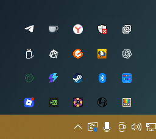
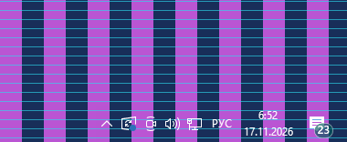
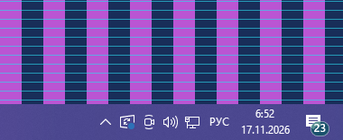

# RustDots


RustDots открывает скрытые значки по штатной стрелке Windows. Панель значков полностью прозрачная, сортирует значки по цвету и сохраняет их штатные клики и контекстные меню. Утилита также умеет менять фон панели задач.

Поддерживается классический трей **Windows 10 x64** (2004–22H2). Утилита проверена на сборке 19045. Системные и вручную закреплённые значки могут оставаться на виду.



## Почему RustDots

- **Небольшой расход памяти.** Поводом для разработки стал случай, когда прежний `TrayDots.exe` занял около 4,7 ГБ оперативной памяти на одном ПК. В отдельном прогоне RustDots 1.2.2 на Windows 10 22H2 пиковая приватная память двух процессов составила **3,4 МиБ**. За 30 секунд простоя их суммарное процессорное время не выросло. [Как повторить замер](#сборка-и-замер)
- **Трей и оформление панели задач в одной утилите.** RustDots настраивает фон из своего процесса через API Windows. В трекере TranslucentTB пользователи сообщали об ошибке копирования `ExplorerHooks.dll` и о сбое запуска после перезагрузки на Windows 10. [Отчёт #1304](https://github.com/TranslucentTB/TranslucentTB/issues/1304) · [Отчёт #1260](https://github.com/TranslucentTB/TranslucentTB/issues/1260)
- **Прозрачность с первого кадра.** На Windows 10 22H2 проверены 60 открытий трея, работа штатных кликов и восстановление после принудительного завершения. [Результаты проверки](#проверка-на-windows-10)

## Установка

[Скачать RustDots-1.2.2.exe для Windows 10 x64](https://github.com/Abobamonster/TrayDots-Rust/releases/download/v1.2.2/RustDots-1.2.2.exe)

Запустите скачанный `.exe`. Установщик работает для текущего пользователя, сразу запускает RustDots в фоне и добавляет его в автозагрузку при входе в Windows. Ярлык появится в меню **Пуск** под именем **RustDots**.

Для обновления с TrayDots Rust запустите новый установщик поверх текущей версии. Профили сохраняются в `%LOCALAPPDATA%\TrayDotsRust`. Удалить программу можно в **Параметры → Приложения → RustDots**.

## Управление

- Левый клик по стрелке открывает и закрывает скрытые значки.
- Правый клик по стрелке открывает настройки фона и автозапуска и позволяет выйти из утилиты.
- **Ctrl+Alt+Shift+T** — открыть или закрыть панель, если сочетание свободно.
- Повторный запуск приложения или ярлык **RustDots** открывает панель, если утилита уже работает.

Значки идут по строкам от белых через красные, оранжевые, жёлтые, зелёные, голубые, синие и фиолетовые до чёрных. Многоцветные значки сортируются по преобладающему цвету. При завершении RustDots восстанавливает прежний режим трея и штатный фон панели задач.

## Фон панели задач

Откройте **ПКМ по стрелке → Панель задач**. Для рабочего стола, видимого или развёрнутого окна, «Пуска», поиска, представления задач и экономии заряда можно выбрать стандартный режим, сплошной цвет, прозрачность, размытие или акрил. Настройка цвета поддерживает RGBA и предпросмотр. В каждом профиле можно отдельно скрыть индикатор кнопки «Показать рабочий стол».

Настройки сохраняются в `%LOCALAPPDATA%\TrayDotsRust\taskbar.json`. При первом запуске RustDots пробует импортировать профиль установленного TranslucentTB. Правила для отдельных приложений и исключения можно задать в JSON по имени процесса, классу или заголовку окна. После правки файла выберите **Перечитать файл настроек**. Оформление применяется ко всем панелям Windows 10, которые включены в настройках мониторов.

## Проверка на Windows 10

Скриншот выше показывает открытую панель скрытых значков. Ниже одна и та же тестовая подложка под панелью задач в двух режимах.

| Прозрачный фон | Акрил |
| --- | --- |
|  |  |

На Windows 10 22H2 (19045) проверены 60 циклов открытия и закрытия трея, восстановление после принудительного завершения и прозрачность при следующем запуске. За 30 секунд простоя суммарное измеренное время CPU обоих процессов не увеличилось. Пиковая приватная память обоих процессов составила около 3,4 МиБ.

## Сборка и замер

Для сборки нужен Rust с целью `x86_64-pc-windows-msvc`.

```powershell
cargo build --release --locked
.\verify.ps1
```

Чтобы собрать установщик, запустите `.\build-installer.ps1` с [NSIS 3.12](https://sourceforge.net/projects/nsis/files/NSIS%203/3.12/). Если `makensis.exe` находится вне `PATH`, передайте его путь через `-Makensis`. Установщик появится в `target`.

`verify.ps1` нужно запускать при остановленном RustDots и на видимой панели задач. Он проверяет доступность стрелки после перестановки элементов трея, прозрачность с первого кадра и после перезапуска, восстановление при обычном и принудительном завершении, память и CPU обоих процессов. Результат пишется в `verification.json`. Ключ `-LeaveRunning` оставляет проверенную сборку запущенной.

В простое нет WinForms, обработки изображений или записи статуса на диск. Основной процесс ждёт сообщения Windows; раз в две секунды проверяет существование и геометрию кнопки. Для сортировки копии значков берутся при открытии и освобождаются при закрытии. Если раскладка Explorer несовместима, остаётся штатное меню. Процесс восстановления ждёт завершения через системный дескриптор. Для переключения режима трея используется закрытый вызов Explorer [ITrayNotify::EnableAutoTray](https://github.com/cairoshell/ManagedShell/blob/master/src/ManagedShell.WindowsTray/TrayNotify.cs). Windows 11 не поддерживается.

Команды: `--toggle`, `--menu`, `--taskbar-reload`, `--quit`, `--startup-on`, `--startup-off`, `--uninstall`, `--restore`. Аварийное восстановление `--restore` выполняется при остановленной утилите. Файл `last-error.txt` появляется только при ошибке фонового запуска или восстановления.
